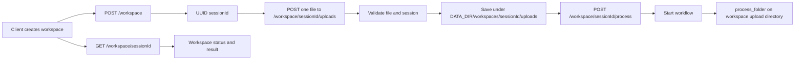
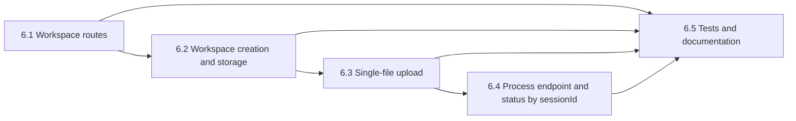

# Epic 6: Upload files to a workspace through an API

## Goal

Let a client create a workspace, upload files to it over multiple API calls, and explicitly start the existing document workflow when uploads are complete. Use one UUID `sessionId` to map the workspace, uploaded files, job status, and outputs.

## Why

A workspace keeps uploaded files together. The client creates the workspace, uploads files one at a time, then calls a separate endpoint to start processing. The client can check job status through the workspace session.

## Depends on

- Epic 4: Docker runtime and persistent data directory.
- Epic 5: Existing upload API, run state, and workflow invocation behavior.
- The existing `process_folder` workflow and supported file-type policy.

## MVP decisions

- `POST /workspace` creates a workspace with a server-generated UUID `sessionId`.
- `POST /workspace/:sessionId/uploads` accepts one file per request.
- The client can select multiple files and send one request for each file.
- Upload requests add one file at a time. They do not start processing.
- `POST /workspace/:sessionId/process` starts processing after uploads are complete.
- `GET /workspace/:sessionId` returns job status and results.
- The same `sessionId` identifies workspace files, status, and results.
- Keep the existing `/api/runs` API available during this change. Do not remove or change its current contract.
- Store workspace data under the configured `DATA_DIR` persistent volume.

## Not in this epic

- Web user interface.
- Cloud storage or remote deployment.
- Public access or multi-tenant authorization.
- ZIP or directory uploads.
- Changes to extraction, classification, or database behavior.
- Run cancellation, retry, or automatic retention policies.

## What this epic produces

| | Before | After |
|---|---|---|
| How a client groups uploads | One upload request creates one run | A workspace groups uploads from multiple requests |
| How files are sent | Multiple files in one request | One file in each request; multiple requests share a `sessionId` |
| When processing starts | After a single bulk upload | After a separate process request |
| How status and outputs are identified | Per-upload `runId` | Workspace `sessionId` |
| Existing API | `/api/runs` | `/api/runs` remains supported |

## API contract

```text
POST /workspace
Content-Type: application/json
Body: optional workspace metadata, such as reportingPeriod
Response: 201 { "sessionId": "<uuid>", "status": "uploading" }

POST /workspace/:sessionId/uploads
Content-Type: multipart/form-data
Fields: file (one file), reportingPeriod (optional if set at workspace creation)
Response: 200 { "sessionId": "<uuid>", "fileCount": 1, "status": "uploading" }

POST /workspace/:sessionId/process
Response: 202 { "sessionId": "<uuid>", "status": "queued" }

GET /workspace/:sessionId
Response: 200 { "sessionId": "<uuid>", "status": "uploading|queued|running|completed|failed", ... }

GET /health
Response: 200 { "status": "ok" }
```

Each upload request contains exactly one file. The server validates the session ID and confirms that the workspace exists before it saves a file. The server creates all filesystem paths. The client must not send a filesystem path or Eve session ID. Responses must not include document text or local absolute paths.

The client calls the process endpoint when uploads are complete. The API must reject uploads to a session that has started processing or finished. A repeated process request must not start a duplicate workflow.

## Read before starting

| Doc or file | Why |
|---|---|
| `epic.md` | Existing Docker and upload API requirements |
| `README.md` | Current setup and workflow behavior |
| `agent/channels/eve.ts` | Existing channel and authentication pattern |
| `agent/channels/upload-api.ts` | Existing routes |
| `agent/lib/upload-api.ts` | Current validation, persistence, workflow, and status behavior |
| Eve custom channel documentation | Route handlers, `from`, and `waitUntil` behavior |
| `agent/lib/document-preparation.ts` | Supported file extensions |

## How it works



1. The client creates a workspace and receives its UUID `sessionId`.
2. The client sends one file per multipart request to that workspace.
3. The server validates the workspace, file, size, name, and extension. It saves the file under the workspace directory and updates workspace metadata.
4. When uploads are complete, the client calls `POST /workspace/:sessionId/process`.
5. The server starts the existing workflow in the background.
6. The workflow reads all files in the workspace upload directory. The API stores status and results against the same `sessionId`.
7. The client polls `GET /workspace/:sessionId` for job status and results.

## Rules

- Bind the service to localhost by default.
- Use `DATA_DIR` for durable workspace and output data.
- Generate an unguessable UUID for each workspace. Never accept a caller-provided ID as a new workspace ID.
- Validate every `sessionId` as a UUID before filesystem use.
- Never use a client-provided path or Eve session ID to choose a filesystem location.
- Require an existing workspace for every upload request.
- Accept exactly one file in each workspace upload request.
- Enforce configurable request, total workspace file-count, total workspace size, and per-file size limits.
- Reject unsupported file types and empty files.
- Sanitize every file name. Reject path separators and path traversal.
- Do not overwrite a file when uploaded names are the same. Give duplicate names a safe suffix.
- Save each file atomically where practical. Do not add a file to workspace metadata until the file is saved successfully.
- If a file save fails, remove its partial file. Keep previously successful uploads intact.
- Start processing only after a valid process request. A repeated request must not start a duplicate workflow.
- Reject uploads after processing starts.
- Write workspace metadata and status atomically.
- Keep each workspace's uploads, status, workflow session ID, and outputs separate from other workspaces.
- Return safe error messages. Do not return stack traces, credentials, document text, or local absolute paths.
- On application restart, mark a queued or running workspace as failed if its workflow did not finish. Do not report false success.
- Keep the existing `/api/runs` behavior available and tested.

## Story order



## Story 6.1: Add workspace channel routes

> As a client, I need routes to create a workspace, upload files to it, and check its status.

### Steps

1. Add or update `agent/channels/upload-api.ts` with Eve's `defineChannel` routes.
2. Add `POST /workspace` to create a workspace.
3. Add `POST /workspace/:sessionId/uploads` to receive one file.
4. Add `POST /workspace/:sessionId/process` to start the job.
5. Add `GET /workspace/:sessionId` to return job status and results.
5. Keep `GET /health` and the existing `/api/runs` routes.
6. Keep routes outside the Eve internal API namespace.
7. Use the existing application lifecycle. Do not start a second server unless the Eve runtime requires it.

### Acceptance criteria

- Eve starts with all workspace, health, and existing upload routes registered.
- A workspace create request returns a UUID `sessionId`.
- The process route starts the job, and the status route reports its state.
- A malformed request returns a clear 4xx JSON response.
- An unknown or malformed session ID cannot access filesystem data and returns an appropriate 4xx response.

## Story 6.2: Create and persist a workspace

> As a client, I need a persistent workspace that I can use for later upload requests.

### Steps

1. Generate a UUID `sessionId` on `POST /workspace`.
2. Create a workspace directory under `DATA_DIR/workspaces/<sessionId>/` and an upload subdirectory.
3. Save workspace metadata with the session ID, creation time, `uploading` status, file list, optional validated reporting period, and job state.
4. Return `201` with the `sessionId` and `uploading` status.
5. Add helpers to load and atomically update workspace metadata by validated session ID.
6. Do not create a workspace from a client-supplied session ID.

### Acceptance criteria

- A new workspace has a UUID and a unique persistent directory.
- Workspace metadata can be loaded after application restart.
- Invalid IDs cannot escape the workspace data root.
- A workspace creation failure does not leave a usable partial workspace.

## Story 6.3: Upload one file per request

> As a client, I need to add files to a workspace before I start processing.

### Steps

1. Require exactly one `file` multipart field at `POST /workspace/:sessionId/uploads`.
2. Validate the session ID and load its workspace metadata. Return `404` if no workspace exists.
3. Reject the request if the workspace is queued, running, completed, or failed.
4. Validate optional `reportingPeriod` or use the validated value saved at workspace creation.
5. Enforce configurable per-request, per-file, total file-count, and total workspace-size limits.
6. Check extensions against `SUPPORTED_EXTENSIONS`; reject empty files and unsafe names.
7. Save the file safely. Handle duplicate file names without overwriting earlier files.
8. Update workspace metadata only after the file save succeeds.
9. Return `200` with `uploading` status.

### Acceptance criteria

- Each request saves exactly one valid file to the correct workspace.
- Invalid file types, names, empty files, and oversized requests return a clear 4xx response.
- A filename cannot write outside the workspace directory.
- A failed file save does not create a file-list entry or a usable partial file.
- Duplicate names do not overwrite prior uploads.
- Uploads persist in the configured Docker volume.
- Uploading a file does not start processing.
- The server rejects uploads after processing starts.

## Story 6.4: Add a process endpoint and report job status by sessionId

> As a client, I need to start processing explicitly and check job status by workspace session ID.

### Steps

1. Add `POST /workspace/:sessionId/process`.
2. Return `404` for an unknown workspace. Reject a workspace with no uploaded files.
3. Start the existing `process_folder` workflow with the server-created workspace upload directory.
4. Start the workflow in the background and return `202` without waiting for processing to finish.
3. Persist `queued`, `running`, `completed`, and `failed` status against the workspace `sessionId`.
4. Save the Eve workflow session ID separately in workspace metadata. Do not confuse it with the public workspace session ID.
5. Save the structured result against the workspace session ID when the workflow completes.
6. Implement `GET /workspace/:sessionId` with UUID validation and `404` for unknown workspaces.
7. Remove document text and local paths from the public status/result response.
8. On workflow failure, save a safe error. Log diagnostic details without file contents or secrets.
9. Mark incomplete workspaces as failed after an application restart.
10. Keep existing `/api/runs/:runId` status behavior available.

### Acceptance criteria

- The workflow processes all files in the workspace when the client calls the process endpoint.
- Status and result lookups use the workspace `sessionId`.
- Status changes to `completed` on success and `failed` on failure.
- Concurrent workspaces use separate directories and metadata.
- A repeated process request does not start a duplicate workflow.
- A restart does not make an unfinished workspace appear complete.

## Story 6.5: Test and document the workspace upload flow

> As the team, we need repeatable proof that a client can upload files over multiple requests.

### Steps

1. Add tests for workspace creation, UUID validation, persistence, and metadata recovery.
2. Add tests for one-file requests, file validation, limits, filename safety, duplicates, and partial-save cleanup.
3. Add tests for explicit process start, exactly-once workflow start, rejected uploads after processing starts, status polling, workflow failure, and unknown sessions.
4. Keep tests for the existing `/api/runs` flow.
5. Mock workflow invocation in unit tests.
6. Add a local end-to-end test: create workspace, upload multiple files in separate requests, call the process endpoint, and poll the same session ID.
7. Document `curl` examples, limits, storage, and cleanup.
8. Run tests, typecheck, build, and the Docker smoke test.

### Acceptance criteria

- Tests cover validation, filesystem safety, upload sequences, process start, and workflow outcomes.
- The end-to-end test proves that separate file requests produce one workflow run.
- The README documents the new workspace routes and keeps the existing `/api/runs` flow documented.
- No customer files or secrets are committed.

## Example client flow

Create a workspace:

```bash
curl -X POST http://127.0.0.1:2000/workspace
```

Example response:

```json
{ "sessionId": "<uuid>", "status": "uploading" }
```

Upload the first file:

```bash
curl -X POST http://127.0.0.1:2000/workspace/<uuid>/uploads \
  -F 'file=@./invoice.pdf'
```

Upload another file if needed:

```bash
curl -X POST http://127.0.0.1:2000/workspace/<uuid>/uploads \
  -F 'file=@./supporting-document.pdf'
```

Start processing after all files are uploaded:

```bash
curl -X POST http://127.0.0.1:2000/workspace/<uuid>/process
```

Poll the same workspace session for job status and results:

```bash
curl http://127.0.0.1:2000/workspace/<uuid>
```

## Out of scope

- Public API access, user accounts, and multi-tenant access control.
- Cloud object storage and signed upload URLs.
- Browser UI, progress streaming, cancellation, and retry controls.
- ZIP extraction and directory upload.
- Removal of the existing `/api/runs` API.
- Changes to business rules in the document workflow.

## Definition of done

- A client can create a workspace and receive a UUID `sessionId`.
- A client can upload one file per request to the same workspace.
- The client can explicitly start the workflow after it uploads all files.
- Workspace files, status, and results map to the same `sessionId`.
- The existing `/api/runs` API remains supported.
- Upload validation, path safety, process start, failure handling, and persistence are tested.
- The API documentation and Docker instructions match the implementation.
